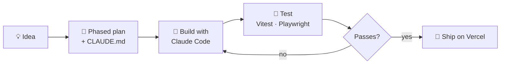

<!-- Animated wave header -->
<p align="center">
  
</p>

<!-- Typing banner -->
<p align="center">
  <a href="https://danielcanlapan.vercel.app">
    
  </a>
</p>

<p align="center">
  <a href="https://danielcanlapan.vercel.app"></a>
  <a href="https://www.linkedin.com/in/daniel-martin-canlapan-1b2760380"></a>
  <a href="mailto:danielcanlapan0402@gmail.com"></a>
  
</p>

---

## 🧭 About me

```ts
const daniel = {
  role: "BS Computer Science Student",
  basedIn: "Philippines 🇵🇭",
  focus: ["Full-stack web", "Interactive 3D & motion", "AI integrations"],
  currentlyLearning: "Vue.js",
  currentlyBuilding: "My first multimodal RAG system",
  workflow: "Claude Code + phased plans + tests before shipping",
  offline: ["graphic design", "digital art", "web design"],
  openTo: "remote freelance & part-time roles",
};
```

---

## 🛠️ Tech stack

<p align="center">
  
  <br/>
  
</p>

<details>
<summary><b>🔍 Click for the full breakdown</b></summary>
<br/>

| Area | What I use |
|------|-----------|
| **Frontend** | React, TypeScript, Vite, Three.js, GSAP, custom shaders, HTML/CSS |
| **Backend** | Node.js, Express, REST APIs, Vercel serverless, JWT auth |
| **Data** | PostgreSQL, Supabase |
| **AI / ML** | Gemini API, TensorFlow.js, pandas, NumPy, scikit-learn |
| **Mobile** | Flutter, Dart |
| **Testing** | Vitest, Playwright |
| **Design** | Figma, Canva |
| **Workflow** | Git, GitHub, Claude Code |

</details>

---

## 🚀 Featured projects

> Click a project to expand it.

<details open>
<summary><b>🖐️ Handoff</b>: an interactive 3D portfolio you shake hands with &nbsp;·&nbsp; <i>solo</i></summary>
<br/>

A rigged 3D hand reaches out. Hold to shake it, and about 120 fragments assemble into a screen with five sections, each with its own pose.

- Three.js, custom shaders, lazy-loaded bloom, GSAP, strict TypeScript on Vite
- Performance tier that steps down on slower devices
- Touch, keyboard and reduced-motion support
- Built with Claude Code in planned phases

[](https://handoff-kappa-one.vercel.app) [](https://github.com/dncnl/handoff)
</details>

<details>
<summary><b>📄 Stackly</b>: merge images, PDFs and Word files into one PDF, fully in the browser &nbsp;·&nbsp; <i>solo</i></summary>
<br/>

Your files never leave your device. A test checks that the app makes zero outside requests.

- React 19, TypeScript, Vite
- Strict Content-Security-Policy, file detection by content (not extension), sanitised Word rendering
- Vitest + Playwright tests
- Calm, typography-led design: ink, warm paper and one oxblood accent

[](https://pdf-compile.vercel.app) [](https://github.com/dncnl/pdf-compile)
</details>

<details>
<summary><b>🍚 Kain</b>: a price-optimized nutrition planner for Filipino families &nbsp;·&nbsp; <i>team · 🏆 Top 30 of 200+ schools, Enactus PH 2026</i></summary>
<br/>

An offline-first PWA. A bounded-knapsack solver picks the most nutritious meal plan within a family's budget, then builds the shopping list and a nutrition chart.

- My role: frontend and backend development, planning and documentation
- Recipe data regenerated from price sources with a build script, plus a Node test suite

[](https://kain-enactus.vercel.app) [](https://github.com/dncnl/kain-enactus-2026)
</details>

<details>
<summary><b>🗺️ MAPA-Sarap</b>: a food directory with an AI assistant &nbsp;·&nbsp; <i>team · I led backend & deployment</i></summary>
<br/>

- PostgreSQL schema and migrations, REST API on Vercel serverless functions
- JWT + bcrypt auth with server-side admin checks
- SarapBot: a Gemini-powered assistant grounded in the app's own database, with retry and fallback model

[](https://sen02-mapa-sarap.vercel.app) [](https://github.com/dncnl/sen02_mapa-sarap)
</details>

<details>
<summary><b>➕ More projects</b></summary>
<br/>

| Project | What it is | My role |
|---------|-----------|---------|
| [**Kalinga**](https://github.com/dncnl/kalinga) | Multilingual, offline-first Flutter care companion for migrant caregivers (Taiwan Presidential Hackathon, International Track) | Frontend & planning |
| [**AUF EnrollAssist**](https://auf-enrollassist.vercel.app) | Enrollment guide with an in-browser MobileBERT Q&A that answers only from official guidelines | Main developer |
| [**Portfolio**](https://danielcanlapan.vercel.app) | My personal site, designed in Figma, built in React | Solo |

</details>

---

## ⚙️ How I build



---

## 📊 GitHub activity

<p align="center">
  
  
</p>

<p align="center">
  
</p>

<!-- Contribution snake (generated by .github/workflows/snake.yml) -->
<p align="center">
  <picture>
    <source media="(prefers-color-scheme: dark)" srcset="https://raw.githubusercontent.com/dncnl/dncnl/output/github-snake-dark.svg" />
    <source media="(prefers-color-scheme: light)" srcset="https://raw.githubusercontent.com/dncnl/dncnl/output/github-snake.svg" />
    
  </picture>
</p>

---

## 🤝 Let's connect

I'm open to remote freelance and part-time work in full-stack, front-end and AI-assisted development. The fastest way to reach me is [LinkedIn](https://www.linkedin.com/in/daniel-martin-canlapan-1b2760380) or [email](mailto:danielcanlapan0402@gmail.com).

<p align="center">
  
</p>
